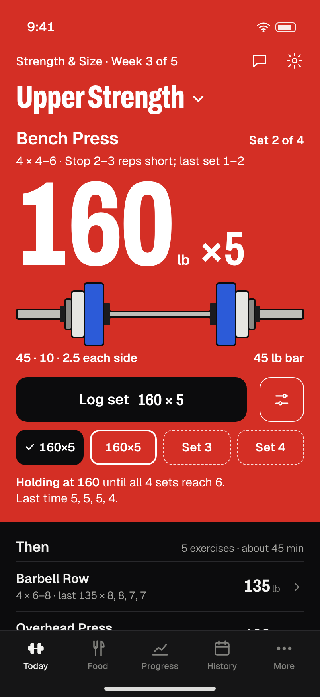
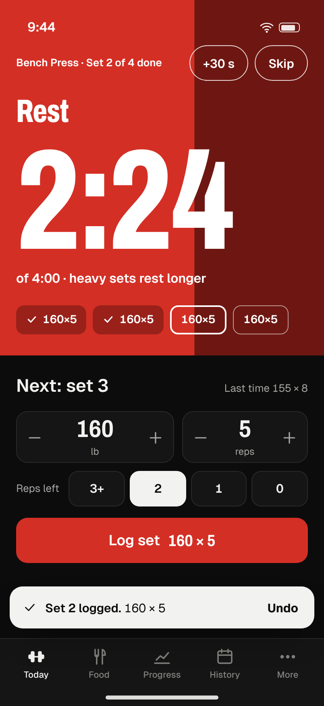
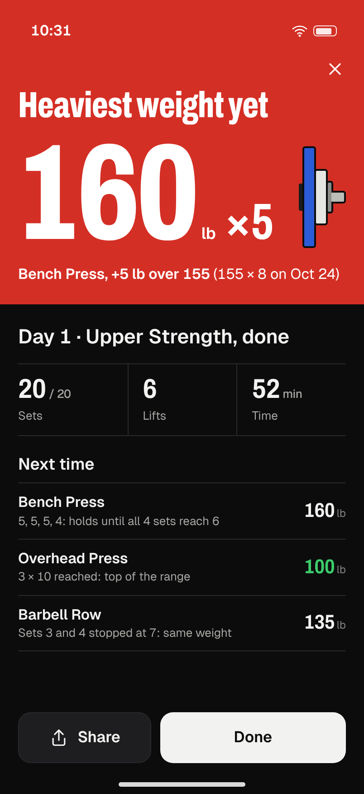
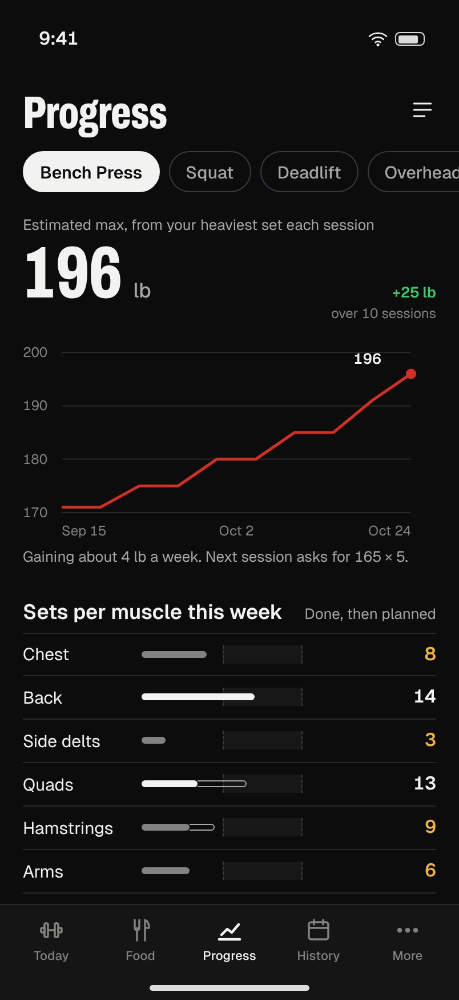
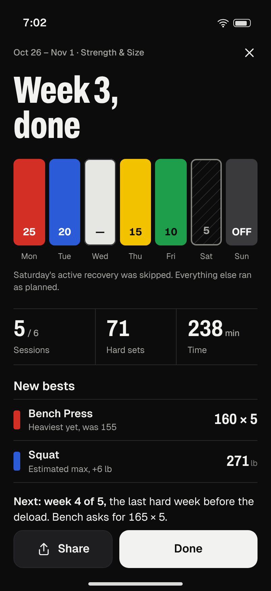

# The pitch

*From all eight agents, after the summit. 7 November 2026. Every figure cites the planning doc it came from.*

---

## The promise

**Proven programs that tell you what to lift next, one tap per set. Free, no ads, no account, and your logs stay on your phone.**
business.md §1. Every clause is true in v3.514 today.

What it should feel like: **a coach handing you a loaded bar**. The next set fills the screen in the colour of the plates you're about to load, one tap from done (design-vision §1).

---

## Why we win: four unfair advantages

### 1. The whole paid stack, free
Every app we compared charges for something we give away. We're the only one with neither ads nor a paywall (research.md §5, last row).

| They charge | For | We |
|---|---|---|
| Hevy Pro $23.99/yr; Strong Pro $29.99/yr | Progression and full stats | Free |
| RP Hypertrophy $34.99/mo | Per-muscle volume | Free (BL-20; BL-31 with your yes) |
| MacroFactor $71.99/yr, no free tier | Adaptive calories | Free (BL-16, BL-17; BL-27 with your yes) |
| MyFitnessPal | Barcode scanning | Free since day one (`lookupBarcode`) |

Prices are dated third-party snapshots from research.md §1. Re-check them before quoting any publicly.

### 2. Programs that show their work
- **The library:** 25 authored programs (business.md §5.1), with 84 cited DOIs in `content-citations.js` (toolchain.md §1).
- **An audit we computed ourselves.** We ran our own programs through the real code and published the failures (program-audit.md).
- **Clinical breadth with a guarantee.** No competitor programs rehab, prenatal or hypertension plans (roadmap theme 1). Ours will carry a test-enforced guarantee: **these plans never auto-increase**, checked over every clinical day × goal × week (BL-01).

### 3. An engine that knows what you actually lifted
- **Readiness.** Recovery apps miss the obvious: Athlytic's targets "do not take into account muscle fatigue" (research.md §4). Ours reads your real sets, RPE, pain regions **and** HRV against your own baseline (BL-21).
- **Progression with the reason shown.** It's free and every number is explained: "all sets hit 10: add weight".

### 4. Private by architecture, not by policy
- **Nothing to breach:** no server, no account, no analytics.
- **First launch** made no external requests and threw no console errors, and the page loaded in 347 ms on localhost (business.md §5.2).
- **Sharing goes outward:** through your phone's share sheet, never to us.

---

## The experience

Five signature moments, rendered at iPhone size in dark and light (`tools/design/renders/`).

### The next set: `today-dark.png`, `today-light.png`

- **"160 lb × 5" in huge type,** in the day's plate colour, readable from a bench a metre away.
- **The plate stack:** 45 · 10 · 2.5 each side, drawn as real plates (UX-07). The plate calculator Strong users love has quietly gone from our app (summit F1). This brings it back with **zero taps**.
- **One Log button,** placed above the middle of the screen. One tap, asserted in a test (UX-06).

### Logging, then resting: `log-set-dark.png`

- **The rest takes over the screen.** The red drains as 2:24 of 4:00 counts down (UX-08).
- **The next set waits below** with big steppers and "Reps left 3+ / 2 / 1 / 0", stored as the same RPE data as today.

### Finishing, and a PR: `pr-dark.png`

- **One screen closes the session:** sets, time and volume, then **"Next time"**, with each change and its reason (UX-09).
- **The auditor caught two errors in this picture,** and they're fixed before it's built:
  - the Bench line should **hold** at 160, because 5 isn't the top of 4–6;
  - "160 × 5" is a *weight* record, not a strength best: its estimated max is 186.7 against the old set's 196.3 (summit F6, F7).

  That's the standard: the screen never celebrates a number our own chart would contradict.

### Am I getting stronger? `progress-dark.png`

- **The answer first:** your estimated max and its line (UX-10).
- **Then sets per muscle this week,** counted the way the latest meta-regression fits best (BL-20, [PEL]).

### The week, in plate colours: `recap-dark.png`

- **A Monday sheet:** seven blocks in each day's ink, sessions done against planned, new bests, and what next week asks (UX-11).
- **The share card uses the same layout,** so what you share is what you saw.

---

## The science edge (from the audit)

**Found and fixed before anyone else saw it:**
- **SAF-1:** with goal "gain" in week 3, ACL rehab day 4 went from 3 sets to **5**, and hypertension volume **doubled**. BL-01 gates it.
- **SAF-2:** RPE mode could prescribe **RPE 9** to hypertension clients and on snatches. BL-02 caps it at 7 and turns RPE off for technique lifts.
- **M-1:** heavy-bag rounds got **240 s** of rest and 40-yard sprints **60 s**. BL-14 makes them 60 s and 120 s [SING24].
- **H-3:** the Bodybuilding 3-day variant gives chest **3 sets a week** and glutes **0**. The rebuild targets 9+ [ACSM26][PEL] (BL-37, with your yes).

**Raised past the paid apps:**
- **All-set double progression:** add weight only when *every* set hits the top of the range (BL-08). Hevy charges for this.
- **A target effort on every set:** reps in reserve by lift type (BL-10) [ROB24][REF23].
- **A streak that counts training weeks:** rest days never break it (MKT-01). Today's daily streak fires at 7 days in a row, one day after readiness warns "6 days without a rest" (marketing.md §0).

**The single biggest lever** (audit §5): a per-muscle weekly ledger driving a ±1-set rule learned from *your* performance. That's RP's engine without the $35 a month, with every number explained.

---

## Growth without ads or tracking

| Mechanism | Evidence | Privacy cost |
|---|---|---|
| **Year in Lifting** (MKT-06), every December | Spotify reports 500M Wrapped shares in about 24 h (company-reported, marketing.md §3.1) | Computed on the phone; no body data |
| **Story-format cards** for PRs, weeks and blocks (MKT-03, MKT-05, MKT-07) | People share achievements, not logs (marketing.md §3.1) | Body data off by default (MKT-02) |
| **The weekly streak** (MKT-01) | Duolingo: 7-day streakers are 2.4× likelier to return (company-reported, correlational) | None beyond how often you train |
| **Friend challenges by link** (MKT-11) | Social comparison raised class attendance about 90% in a 790-person RCT (Zhang 2016) | The link carries only the rule, in the URL fragment, which never reaches a server |
| **Easy to leave, easy to join:** CSV export (BL-22), import from Strong or Hevy (BL-29) | Switchers care about CSV fidelity (research.md §4, second-hand) | None |

**The only referral loop is the address printed on the card** (BIZ-08). There's no attribution tag (MKT-15) and no analytics. We measure through the store consoles plus an on-device first-month row (BIZ-09).

---

## The business

- **Free core forever, no ads:** logging, programs, progression, food, and backup to your own cloud (BIZ-11, BIZ-13).
- **Paid only for things that cost money to run:** hosted AI (so no key is needed) and encrypted sync, sold through the store builds. Priced under MacroFactor's $71.99/yr. **No billing code until 90 days of store retention data** (business.md §3).
- **North star: weekly active trainers,** people logging ≥2 sessions a week (business.md §4). The category's day-30 retention is 3–8% (business.md §4). An app you use on a schedule should beat that by a wide margin.
- **Distribution:** web now, Google Play first through the Capacitor build, then the App Store. Store fees are about $25 one-time for Play and $99/yr for Apple; check before paying (business.md §6).

---

## The plan

There are 89 items: 58 ready and 31 that need you. That becomes **60 ready builds in one order**, each its own tested version and PR (roadmap.md, Unified build sequence).

| Phase | What ships | Builds |
|---|---|---|
| **0. Safety** | Clinical gates, RPE caps, injury-region flags, safety cues, cycle-card honesty | 6 |
| **1. Engine truth + Year in Lifting** | All-set progression, RIR targets, smarter increments and deloads, correct rest; design tokens (no visual change); the YIL lane (MKT-02 → MKT-03 → MKT-06a, **target 30 Nov**) | 18 |
| **2. Redesign core** | Flat world, new tab bar, the cover, the plate stack, rest on the cover, the finish sheet and PR, Progress, the unfolded Duo layout, the weekly recap | 16 (+1 with the font) |
| **3. First week and data trust** | Quick start, honest first screen, backup nudge at 3 sessions, install hint, CSV export, recent foods | 11 |
| **4. Bar-raisers and growth** | Trend weight, expenditure, HRV readiness, PR gain cards, block card, History, Food, cleanup; then your approved engine and program upgrades | 8 (+ up to 12 approved) |
| **5. Public launch** | Clinical acknowledgement, privacy page, landing page, address on cards, the name; then program links and challenges | about 8 after your yes |

At one merge a day (your pace, an assumption) that's about two months of ready work. It moves only as fast as you review, and **nothing goes live without your yes.**

### The first two weeks
1. **You:** answer D1. That means merging `planning/` into `Branch-1` and starting the build loop.
2. **Build-automator:** a planning-only PR so runs follow this sequence instead of file order.
3. **Design-engineer:** fix the five mock-up errors (summit R1) and re-render.
4. **Builds 1–6, Phase 0:** BL-01, BL-02, BL-03, BL-04, BL-05 with BL-06, BL-13.
5. **Builds 7–12:** BL-08, UX-01, BL-07, MKT-02, MKT-03, MKT-06a. That leaves slack before 30 November.
6. **Auditor:** verify the three citations still marked unverified (the Pelland date, Plews 2013, the Hacker's Diet) before they reach the app (needs D10).
7. **You, if yes:** send one Strong or Hevy export file (D6), and reserve `chalklog.app` (D7).

---

## Decisions only you can make

### Owner's answers, 2026-11-07
- **Name:** Chalklog. In-app rename shipped on the working branch as v3.515, display name only, with storage keys unchanged. The domain and USPTO check (D7) are still to do before the name is used publicly.
- **Design:** Plate & Press for the app, plus the hybrid edge additions: the race bib as the story card, "Your number", "Pin it on", and the bib with the loaded bar as the constant (design-directions.md §5–§6, MKT-16 to MKT-18).
- **Icon:** approved, as a stripe of the five plate colours used as both the icon and the card mark (MKT-19).
- **Money (D9, revised):** free at launch, with a subscription later. The business manager is reworking the model to fit (business.md).
- **Still open:** D1–D6, D8 and D10.

| # | Question | Recommended | Unblocks |
|---|---|---|---|
| **D1** | Merge `planning/` and start the build loop (7:17, 13:17 and 20:17 ET), reviewing about one PR a day? | **Yes** | Every build. Year in Lifting by 30 Nov needs about 12 merges. |
| **D2** | Ship the 90 KB Archivo font (UX-02); move the chat button into the header (UX-16); retire Gym mode two weeks after the new Today (UX-17); confirm PRODUCT.md and the plate world? | **Yes to all** | The redesign at full fidelity |
| **D3** | Let the engine adapt: ±1 set per muscle per week (BL-31); deloads count only weeks you trained (BL-33); RPE-adjusted e1RM (BL-34); readiness (BL-32); the ledger on Today (BL-30)? | **Yes** to BL-31 and BL-33; BL-34 **only for RPE-mode targets** (PR history stays put); BL-32 as a **one-tap "make today easier"**, not automatic; BL-30 **no** | The RP- and Juggernaut-beating engine |
| **D4** | Apply the audit's program fixes: appends (BL-36, BL-39, BL-40) and slot rewrites with migrations (BL-35, BL-37, BL-38)? | **Yes**, one migration per version; old neck-bridge sets archived | Proper dose in Bodybuilding 2/3/4-day, Strength & Size and Powerbuilding; also needed before strangers reach the 3-day variants |
| **D5** | Weekly calorie check-in, applied only on Accept (BL-27); saved meals (BL-28)? | **Yes**; BL-27 after BL-17 has 3 weeks of data | Our free answer to MacroFactor |
| **D6** | Strong/Hevy import into a separate "Imported" archive feeding PRs and e1RM (BL-29); one dated, sourced comparison page (MKT-12)? | **Yes**, and send one real export file | The switchers' door |
| **D7** | Rename publicly to **Chalklog** ("Chalklog: Training Log") after buying `chalklog.app` and a USPTO check, with Liftnext as the fallback; redraw the icon flat (MKT-09)? | **Yes**; the rename ships in Phase 5 and storage keys never change | Store listing, card wordmark, launch |
| **D8** | Go public after Phase 3: web now, Play then App Store (BIZ-12), with a privacy page (BIZ-16), landing page (MKT-14), clinical acknowledgement and claims review (BIZ-15), the address on cards (BIZ-08) and launch posts (MKT-13)? | **Yes, in that order** | Phase 5 |
| **D9** | Money and links: "free core, no ads, ever" (BIZ-11); hosted AI (BIZ-14); off-device backup (BIZ-13); ref tags (MKT-15); program links and challenges (MKT-10, MKT-11)? | BIZ-11 **yes**; BIZ-14 **not yet**; BIZ-13 **own cloud via the share sheet, no server**; MKT-15 **no**; MKT-10 and MKT-11 **yes, after BIZ-08** | The business model and serverless sharing |
| **D10** | Approve tools: paper-lookup, axe-core (devDependency), Playwright WebKit, a `ship-increment` skill, and the `Skill` tool for three agents? | **Yes**; the rest of toolchain §7 is optional | Verified citations; Safari-engine and accessibility checks for the redesign |

---

## What we're deliberately NOT doing
- **No social feed.** It's a complaint at Hevy (research.md §4).
- **No ads,** ever. **No paywall** on anything that costs nothing to run.
- **No generated Fitbod-style workouts.** Proven programs only.
- **No exercise demos, 3D or AI video.** You parked them (HANDOFF-v59, Addendum 41).
- **No analytics, attribution or tracking.** No server, no accounts, and no hosted AI yet.
- **No made-up "readiness score".** Confetti, badges, XP and streak guilt are retired too.
- **No body weight, intake or health data on a share card** unless you turn it on. **No share buttons on clinical programs.**
- **No health claims in public copy** ("safe", "rehab", "prevents"), and no competitor names in store keywords.
- **No watch or lock-screen logging in the PWA.** That's the Capacitor track's job, and we don't touch `android/`.
- **No new verticals** until weekly active trainers can be measured.
